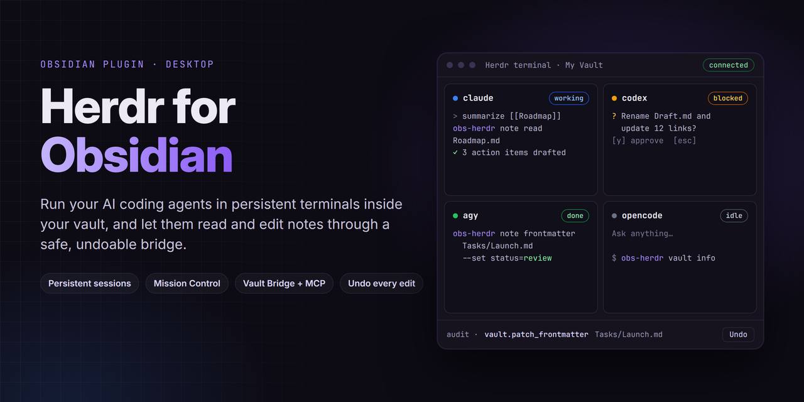
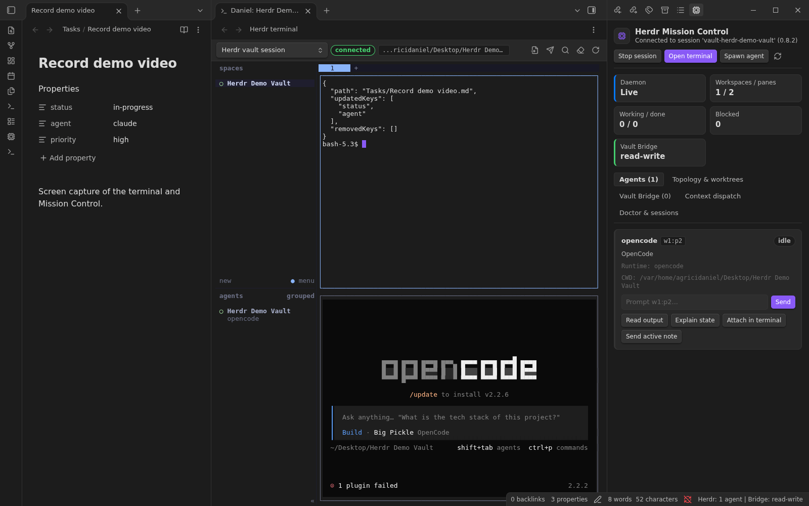
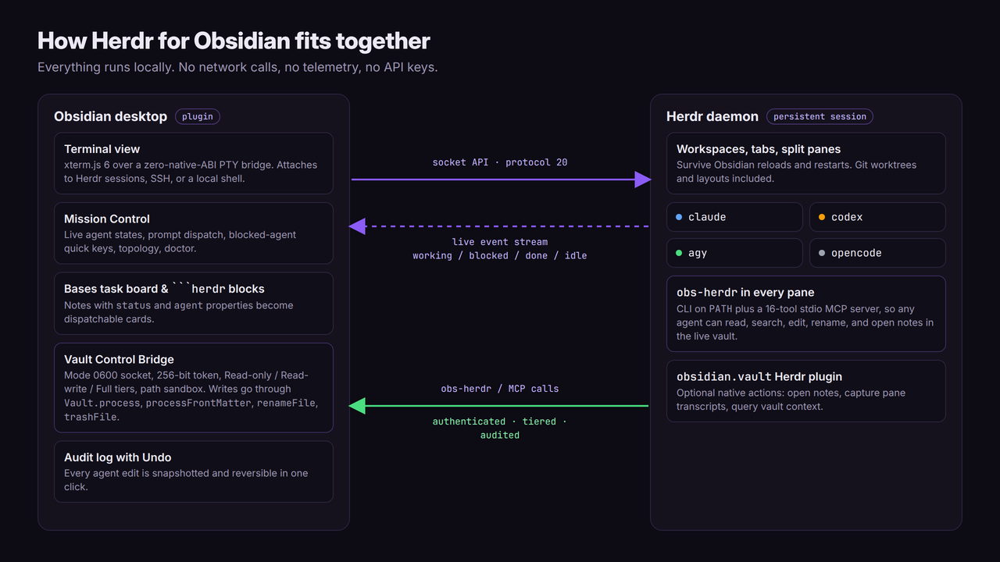

<p align="center">
  
</p>

<p align="center">
  <a href="https://github.com/AgriciDaniel/obsidian-herdr/actions/workflows/ci.yml"></a>
  
  
  
  <a href="LICENSE"></a>
</p>

<p align="center">
  <b>Claude Code, Codex, Antigravity and OpenCode, side by side, inside Obsidian.</b><br>
  Persistent agent sessions, real terminals, and a safe bridge that lets agents read and edit your notes, with every change undoable.
</p>

---


## Why

Your notes and your coding agents live in two different worlds. Agents run in a terminal somewhere, your context lives in Obsidian, and you copy and paste between them.

**Herdr for Obsidian** puts them in one place:

- Your agents run in **[Herdr](https://github.com/herdrdev/herdr)** sessions that survive Obsidian reloads and restarts.
- You watch, prompt, and unblock every agent from **Mission Control** in the sidebar.
- Agents work with the **live vault** through `obs-herdr`, a CLI and MCP server that goes through Obsidian's own APIs, so links update on rename and every edit lands in an **audit log with Undo**.

Everything runs locally. No network requests, no telemetry, no accounts, no API keys.

## Features

### Real terminals, persistent agents

Embedded xterm.js terminals attach to a Herdr session for your vault, to a remote `herdr --remote` host over SSH, or to a plain local shell. Split panes, tabs, and workspaces live in the Herdr daemon, so closing a tab or reloading Obsidian does not kill your agents.



### Mission Control

A live dashboard driven by Herdr's event stream: every agent with its state (**working**, **blocked**, **done**, **idle**), a prompt box per agent, quick keys to approve or cancel a blocked agent, output previews, workspace topology and Git worktrees, plus a doctor panel for sessions and sockets.

### Vault Control Bridge, with Undo

Every pane gets `obs-herdr` on its `PATH`. Agents can read, search, create, update, patch frontmatter, rename (link-safe), trash, and open notes. Writes go through `Vault.process`, `FileManager.processFrontMatter`, `FileManager.renameFile`, and `FileManager.trashFile`, never raw file writes. Each one is logged with a snapshot and a one-click **Undo**.


### Agent task board in Obsidian Bases

Add a `Herdr task board` view to any Base. Notes with `status` and `agent` properties become cards that show the matching live agent and dispatch the note to it in one click.


### Agent cards inside notes

A `herdr` codeblock turns a note into a launch pad: a saved prompt, the live agents, and buttons to open a terminal or send the prompt.

````markdown
```herdr
title: Research assistant
agent: claude
prompt: Summarize [[Research/Agent Workflows]] into three action items.
```
````


### And more

- Ctrl or Cmd click `[[wiki links]]`, `obsidian://` URIs, and `path/to/note.md:12` in terminal output to open the note at that line.
- Send the active note, the selection, its frontmatter, and its backlink neighborhood to any agent from the command palette, context menus, or Mission Control.
- An optional `obsidian.vault` Herdr plugin adds native Herdr actions: open notes, capture pane transcripts, query vault context.
- Terminal colors and fonts follow your Obsidian theme, dark or light.
- Every setting is searchable from Obsidian's settings search, with editable terminal profiles.

## How it works



## Quick start

### Requirements

- Obsidian desktop **1.14.4** or newer (Linux, macOS, or Windows).
- **[Herdr](https://herdr.dev) 0.8 or newer** on your `PATH` (or in `~/.local/bin`) for persistent sessions and Mission Control. Local shell terminals and the Vault Bridge work without it.
- Python 3 is used for the PTY bridge on macOS and Linux when available, with an automatic fallback.
- Any agents you like: Claude Code, Codex, Antigravity, OpenCode, Copilot, Cursor, and the others Herdr detects.

### Install

**From a release (recommended).** Download `main.js`, `manifest.json`, and `styles.css` from the [latest release](https://github.com/AgriciDaniel/obsidian-herdr/releases) into `<your vault>/.obsidian/plugins/herdr/`, then enable **Herdr** under **Settings, Community plugins**.

**With BRAT.** Add `AgriciDaniel/obsidian-herdr` as a beta plugin.

**From source.**

```bash
git clone https://github.com/AgriciDaniel/obsidian-herdr.git
cd obsidian-herdr
npm ci
npm run build
# copy main.js, manifest.json and styles.css into <vault>/.obsidian/plugins/herdr/
```

### Try the demo vault

The [`demo-vault/`](demo-vault) folder has the notes, task Base, and `herdr` codeblock from the screenshots. Copy the three plugin files into `demo-vault/.obsidian/plugins/herdr/`, open the folder as a vault, and run **Herdr: Start persistent session for this vault**.

### First run

1. Open **Herdr Mission Control** from the ribbon or the status bar.
2. Click **Start session**, then **Open terminal**.
3. Start an agent in a pane (`claude`, `codex`, `agy`, `opencode`), or use **Spawn agent**.
4. Ask it to use the vault: `obs-herdr --skill` prints instructions an agent can follow.

## `obs-herdr` and MCP

```bash
obs-herdr vault info
obs-herdr note search "roadmap"
obs-herdr note read "Roadmap.md"
obs-herdr note create "Specs/Plan.md" --content "# Plan"
obs-herdr note update "Daily/2026-11-09.md" --mode append --content "- shipped"
obs-herdr note frontmatter "Roadmap.md" --set status=in-progress
obs-herdr note rename "Specs/Plan.md" "Specs/Approved Plan.md"
obs-herdr note backlinks "Roadmap.md"
obs-herdr canvas upsert "Architecture.canvas" --type text --text "Milestone 2 ready"
obs-herdr workspace open "Specs/Approved Plan.md" --line 1 --pane split

obs-herdr --skill   # instructions for an agent
obs-herdr mcp       # stdio MCP server with 16 tools
```

To connect Claude Code, Codex, or any MCP client, click **Copy MCP JSON config** in **Mission Control, Vault Bridge**.

## Security and privacy

- **Local only.** The plugin makes no HTTP or WebSocket requests and collects no telemetry.
- **Authenticated bridge.** A mode 0600 Unix socket (or a per-user named pipe on Windows) in a mode 0700 folder outside your vault, protected by a 256-bit token compared in constant time.
- **Permission tiers.** Off, Read-only, Read-write (default), and Full (adds running Obsidian commands). Change it any time from Mission Control.
- **Path sandbox.** Paths are vault-relative. Writes to `.obsidian`, `.git`, and `.env` files are refused.
- **Reversible.** Every write is snapshotted and can be undone from the audit log.
- **Desktop only.** The plugin spawns local processes (your shell, `herdr`, Python 3 for the PTY) without shell interpolation.

## Status

| Area | State |
| --- | --- |
| Linux (Fedora Kinoite, Flatpak Obsidian 1.15, Wayland) | Tested live with Herdr 0.8.2, Claude Code, Codex, Antigravity, and OpenCode |
| macOS and Windows | Code paths implemented and unit tested where portable; not yet tested on real machines |
| Community plugin directory | Not submitted yet |

Bug reports and test results from macOS and Windows are very welcome.

## Development

```bash
npm ci
npm run check   # TypeScript
npm run lint    # eslint-plugin-obsidianmd, zero warnings
npm run build   # main.js
npm test        # unit tests, live PTY, Vault Bridge + MCP, and a live Herdr daemon test when herdr is installed
```

Design notes live in [`docs/`](docs): [architecture](docs/ARCHITECTURE.md), [data and migrations](docs/DATA_AND_MIGRATIONS.md), [UI states](docs/UI_STATE_SPEC.md), and the [acceptance record](docs/ACCEPTANCE.md).

## Credits

Built by [Daniel Agrici](https://github.com/AgriciDaniel). Powered by [Herdr](https://github.com/herdrdev/herdr) (Apache 2.0) and [xterm.js](https://github.com/xtermjs/xterm.js) (MIT). This is an independent community plugin, not an official Herdr or Obsidian project.

## License

[MIT](LICENSE). Third-party notices are in [THIRD_PARTY_NOTICES.md](THIRD_PARTY_NOTICES.md).
