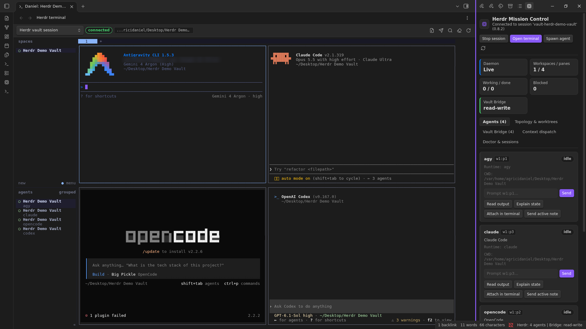
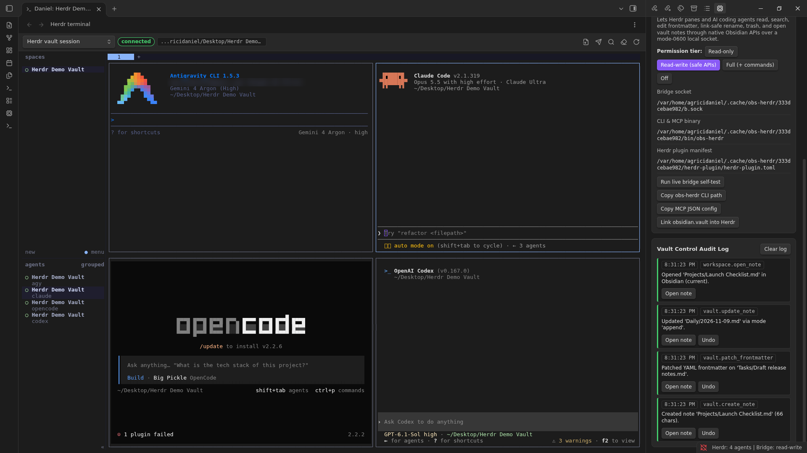
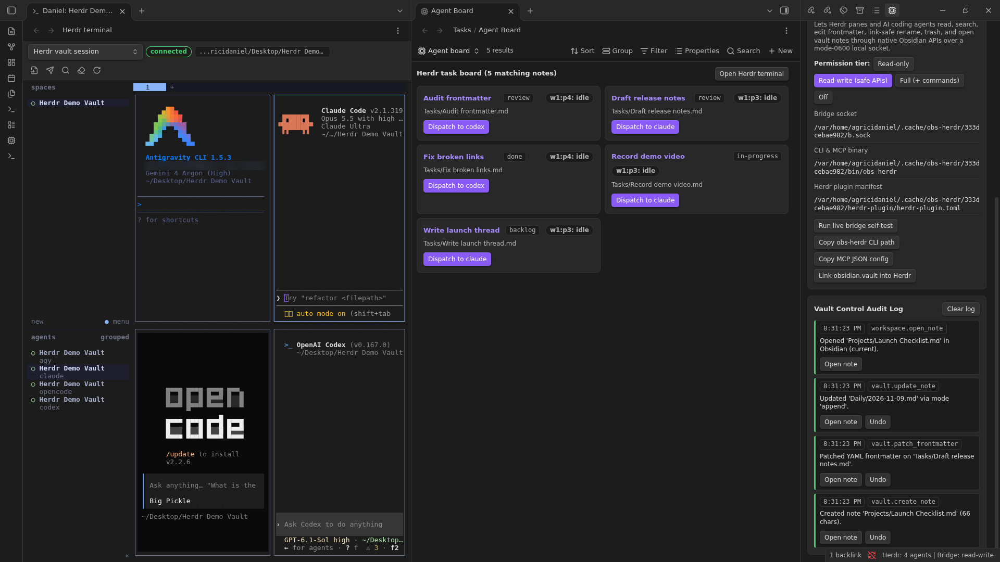
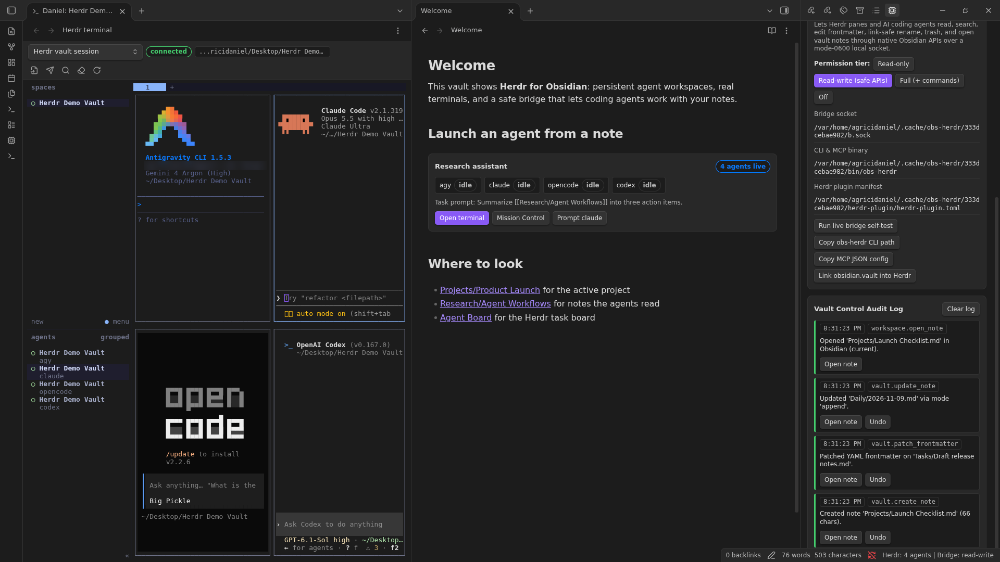

<p align="center">
  
</p>

<p align="center">
  <a href="https://github.com/AgriciDaniel/obsidian-herdr/actions/workflows/ci.yml"></a>
  <a href="https://github.com/AgriciDaniel/obsidian-herdr/releases/latest"></a>
  <a href="LICENSE"></a>
</p>

Run Claude Code, Codex, Antigravity and OpenCode inside Obsidian. They keep running when you close a tab or restart. They can read and edit your notes. Every edit is logged, and you can undo it.



## What you get

- **Real terminals in Obsidian.** Split panes and tabs. Run any agent you like.
- **Agents that keep running.** [Herdr](https://github.com/herdrdev/herdr) holds the session, so a reload does not stop them.
- **Mission Control.** See which agent is working, blocked or done. Unblock one with a click.
- **Safe note edits.** Agents edit notes through Obsidian itself, so links stay intact.
- **Undo for everything.** Each agent edit is logged and can be rolled back.

<p align="center">
  
</p>

## Install

1. Install [Herdr](https://herdr.dev) (0.8 or newer).
2. Download `main.js`, `manifest.json` and `styles.css` from the [latest release](https://github.com/AgriciDaniel/obsidian-herdr/releases/latest) into `<your vault>/.obsidian/plugins/herdr/`. Or add `AgriciDaniel/obsidian-herdr` in [BRAT](https://github.com/TfTHacker/obsidian42-brat).
3. Turn on **Herdr** in Settings, Community plugins.

Needs Obsidian desktop 1.14.4 or newer.

## First run

1. Click **Herdr** in the status bar to open Mission Control.
2. Click **Start session**, then **Open terminal**.
3. Start an agent: `claude`, `codex`, `agy` or `opencode`.
4. Ask it to work on a note. Every pane already has the `obs-herdr` tool, and `obs-herdr --skill` tells the agent how to use it.

Want to look around first? Open the [`demo-vault`](demo-vault) folder as a vault and copy the three plugin files into its `.obsidian/plugins/herdr/`.

## Screenshots

| Audit log with Undo | Agent task board | Agent buttons in a note |
| --- | --- | --- |
|  |  |  |

## Privacy

- Runs on your machine. No network calls, no telemetry, no account, no API keys.
- You choose what agents may do: Read-only, Read-write or Full. Turn it off any time.
- The settings folder, `.git` and `.env` files are always off limits.

## Status

Tested on Linux with Herdr 0.8.2 and four agents running at once. macOS and Windows are not tested yet. Reports are welcome in [Issues](https://github.com/AgriciDaniel/obsidian-herdr/issues).

<details>
<summary><b>For developers</b></summary>

### `obs-herdr` commands

```bash
obs-herdr vault info
obs-herdr note search "roadmap"
obs-herdr note read "Roadmap.md"
obs-herdr note create "Specs/Plan.md" --content "# Plan"
obs-herdr note update "Daily/2026-11-09.md" --mode append --content "- shipped"
obs-herdr note frontmatter "Roadmap.md" --set status=in-progress
obs-herdr note rename "Specs/Plan.md" "Specs/Approved Plan.md"
obs-herdr workspace open "Specs/Approved Plan.md" --pane split
obs-herdr mcp   # stdio MCP server, 16 tools
```

To connect an MCP client, click **Copy MCP JSON config** in Mission Control, Vault Bridge.

### How the bridge is protected

A local socket with owner-only permissions, a random 256-bit token per session, and vault-relative paths only. Writes go through Obsidian's `Vault.process`, `processFrontMatter`, `renameFile` and `trashFile`.

### Build and test

```bash
npm ci
npm run check && npm run lint && npm run build && npm test
```

Design notes and the test record are in [`docs/`](docs).

</details>

## Credits

Built by [Daniel Agrici](https://github.com/AgriciDaniel). Uses [Herdr](https://github.com/herdrdev/herdr) and [xterm.js](https://github.com/xtermjs/xterm.js). Pixel art from The Homies. Not an official Herdr or Obsidian project.

[MIT License](LICENSE)
