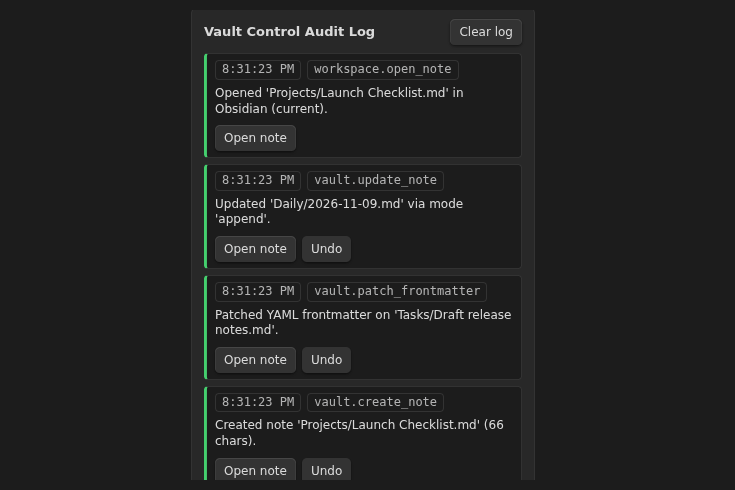
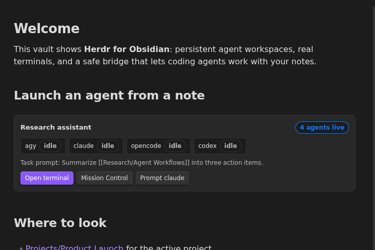

<p align="center">
  
</p>

<p align="center">
  <a href="https://github.com/AgriciDaniel/obsidian-herdr/actions/workflows/ci.yml"></a>
  <a href="https://github.com/AgriciDaniel/obsidian-herdr/releases/latest"></a>
  <a href="#license"></a>
</p>

Run Claude Code, Codex, Hermes, Antigravity, OpenCode, Gemini and more than a dozen other coding agents inside Obsidian. They keep running when you close a tab or restart. They can read and edit your notes, and if you allow it, see and use Obsidian itself. Every edit is logged, and you can undo it.


## What you get

- **Real terminals in Obsidian.** Split panes and tabs. Run any agent you like.
- **Agents that keep running.** [Herdr](https://github.com/herdrdev/herdr) holds the session, so a reload does not stop them.
- **Mission Control.** See which agent is working, blocked or done. Unblock one with a click.
- **Safe note edits.** Agents edit notes through Obsidian itself, so links stay intact.
- **Agents that can use Obsidian.** If you turn it on, agents take screenshots, click, type and press shortcuts in the Obsidian window, just like you.
- **Undo for everything.** Each agent edit is logged and can be rolled back.

## Works with your agents

Claude Code, Codex, Hermes Agent, Antigravity, Gemini, OpenCode, Cursor CLI, GitHub Copilot CLI, Amp, Factory Droid, Grok, Kimi CLI, Kiro CLI, Qwen Code, Devin, Cline, Kilo Code, Mastra Code, Qoder CLI, Pi, Oh My Pi and Maki.

Pick any of them from **Spawn agent** in Mission Control. Run `herdr integration install <agent>` once so Herdr can show when it is working, blocked or done. Any other command line tool runs fine in the terminal too.

## Let agents use Obsidian

Some things only the app can show: a view, a plugin panel, a layout. Turn on **Let agents see and operate Obsidian** in Herdr settings and agents can:

- **See.** Take a screenshot of the window and list its buttons and fields.
- **Act.** Click, type, press shortcuts like `Ctrl+P`, scroll and drag. This also needs the **Full** permission level.
- **Check.** Wait until some text appears, so they confirm what happened.

It is off by default. Typing that changes the open note is logged and can be undone like any other edit.

<p align="center">
  
</p>

## Install

1. Install [Herdr](https://herdr.dev) (0.8 or newer).
2. Download `main.js`, `manifest.json` and `styles.css` from the [latest release](https://github.com/AgriciDaniel/obsidian-herdr/releases/latest) into `<your vault>/.obsidian/plugins/herdr-obs/`. Or add `AgriciDaniel/obsidian-herdr` in [BRAT](https://github.com/TfTHacker/obsidian42-brat).
3. Turn on **Herdr Mission Control** in Settings, Community plugins.

Needs Obsidian desktop 1.14.4 or newer.

## First run

1. Click **Herdr** in the status bar to open Mission Control.
2. Click **Start session**, then **Open terminal**.
3. Start an agent: `claude`, `codex`, `hermes`, `agy`, `opencode` or any other.
4. Ask it to work on a note. Every pane already has the `obs-herdr` tool, and `obs-herdr --skill` tells the agent how to use it.

Want to look around first? Open the [`demo-vault`](demo-vault) folder as a vault and copy the three plugin files into its `.obsidian/plugins/herdr-obs/`.

## Screenshots

| Audit log with Undo | Agent task board | Agent buttons in a note |
| --- | --- | --- |
|  |  |  |

## Privacy

- Runs on your machine. No network calls, no telemetry, no account, no API keys.
- You choose what agents may do: Read-only, Read-write or Full. Turn it off any time.
- The settings folder, `.git` and `.env` files are always off limits.
- Screenshots stay on your machine in a private folder. Like note text, anything an agent reads or sees goes to that agent's provider, so leave UI control off for windows you would not share.

### Network use

None. The plugin makes no internet requests. It talks to Herdr and to your agents only through local sockets on this computer.

### Requires an external program

It needs [Herdr](https://herdr.dev), which you install yourself. The plugin starts Herdr and your shell as local processes, which is why it is desktop only.

### Files outside the vault

The plugin keeps a private runtime folder at `~/.cache/obs-herdr/` (your temp folder on Windows). It holds the bridge socket, the `obs-herdr` command for agents, its connection details, and UI control screenshots. Delete the folder at any time; it is recreated when needed.

## Status

Tested on Linux with Herdr 0.8.2 and four agents running at once. UI control was tested live in Obsidian 1.15.0 on Linux (Flatpak, Wayland). macOS and Windows are not tested yet. Reports are welcome in [Issues](https://github.com/AgriciDaniel/obsidian-herdr/issues).

<details>
<summary><b>For developers</b></summary>

### `obs-herdr` commands

```bash
obs-herdr vault info
obs-herdr note search "roadmap"
obs-herdr note read "Roadmap.md"
obs-herdr note create "Specs/Plan.md" --content "# Plan"
obs-herdr note update "Daily/2026-11-09.md" --mode append --content "- shipped"
obs-herdr note frontmatter "Roadmap.md" --set status=in-progress
obs-herdr note rename "Specs/Plan.md" "Specs/Approved Plan.md"
obs-herdr workspace open "Specs/Approved Plan.md" --pane split
obs-herdr ui screenshot            # saves a PNG and prints its path
obs-herdr ui inspect --text "Settings"
obs-herdr ui click --selector ".workspace-leaf.mod-active .cm-content"
obs-herdr ui key Mod+P
obs-herdr ui type "Hello from an agent"
obs-herdr mcp   # stdio MCP server, 24 tools
```

UI control goes through Electron's own capture and input APIs from inside the plugin, so it needs no debugging port and no extra install. Selectors must match exactly one visible, uncovered element, password fields are refused, and input from several agents is queued so it never interleaves.

To connect an MCP client, click **Copy MCP JSON config** in Mission Control, Vault Bridge.

### How the bridge is protected

A local socket with owner-only permissions, a random 256-bit token per session, and vault-relative paths only. Writes go through Obsidian's `Vault.process`, `processFrontMatter`, `renameFile` and `trashFile`.

### Build and test

```bash
npm ci
npm run check && npm run lint && npm run build && npm test
```

Design notes and the test record are in [`docs/`](docs).

</details>

## Credits

Built by [Daniel Agrici](https://github.com/AgriciDaniel). Uses [Herdr](https://github.com/herdrdev/herdr) and [xterm.js](https://github.com/xtermjs/xterm.js). UI control comes from Obsidian Control Center, also by Daniel. Pixel art from The Homies. Not an official Herdr or Obsidian project.

## License

[MIT](LICENSE), except the UI control module in [`src/control`](src/control), which is [Apache 2.0](src/control/LICENSE). If you reuse that module, keep the [NOTICE](NOTICE) file with it.
